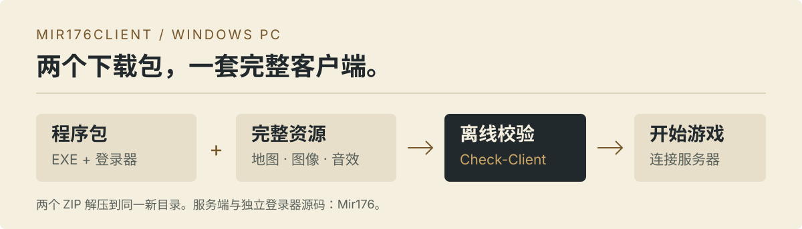

# Mir176Client

**Mir176 的 Windows 游戏客户端、完整资源包与离线文件校验。**

[下载程序与资源](https://github.com/suneveryday/Mir176Client/releases) · [客户端源码](client/current-source/) · [服务端与登录器](https://github.com/suneveryday/Mir176) · [资源清单](resources/manifest.json)

<picture>
  <source media="(max-width: 600px)" srcset="assets/readme/assembly-mobile.svg">
  
</picture>

本仓库维护 Mir176 的 PC 客户端源码、Win32 编译适配、资源索引和下载包。游戏程序与大型素材分开下载，服务端和独立登录器源码由 [Mir176](https://github.com/suneveryday/Mir176) 维护。

## 三步准备客户端

1. 从 Release 下载 `Client-Program` 与 `Resources` 两个 ZIP，解压到**同一个新目录**。
2. 双击 `Check-Client.cmd`，等待程序与全部资源检查通过。
3. 打开 `Mir176Launcher.exe`，填写服务提供者给出的地址和登录端口，再在游戏窗口输入账号和密码。

```text
客户端目录/
├── Mir2Classic176.exe
├── Mir176Launcher.exe
├── Check-Client.cmd
├── Map/
├── Resource/
├── Wav/
└── Data/
```

程序包已包含独立登录器，无需另行下载。请先正常退出游戏，再更换程序或连接地址。Windows 使用 Win32 兼容运行；新系统如缺少图形运行库，请使用 [微软官方 DirectX 运行库](https://www.microsoft.com/en-us/download/details.aspx?id=8109)。

## 下载什么

| 包 | 用途 | 大小 |
| --- | --- | --- |
| `Client-Program` | 游戏 EXE、登录器及校验工具 | 约 3.2 MB |
| `Resources` | 完整地图、图像和音效，共 1254 份文件 | 约 1.68 GB |
| `Server-Maps` | 仅供服务端 Docker 部署使用的 264 份共用地图 | 约 7.2 MB |

资源集合为 `assets-ca77a19cb580`。文件大小、SHA256 和配套版本见 [distribution.json](distribution.json) 与 [resources/](resources/README.md)。大型素材保存在 Release 中，拉取源码不会下载这些 ZIP。

## 开发入口

| 目录 | 内容 |
| --- | --- |
| [client/current-source/](client/current-source/) | Delphi 游戏源码和第三方源码依赖 |
| [client/package/](client/package/) | 本地配置和文件校验工具 |
| [tests/](tests/) | 离线回归与安装组合检查 |

使用具有有效许可的 Delphi 13 CE Win32 工具链构建 `client/current-source/Source/MirClient/MirClinet.dproj`，配置为 Release / Win32。仓库不包含商业工具链；资源和独立登录器另行取得。自行编译的 EXE 需要生成自己的散列清单。

```sh
python3 tools/check-contract.py
python3 tools/check-privacy.py
python3 -m unittest discover -s tests/release-packaging -v
```

当前客户端 **0.1.5** 配套服务端 **0.1.4**、登录器 **0.1.6**。完整服务端、PC、GM 与 bot 运行组合仍为 `pending_runtime_validation`，该预览版不代表逐参数认证的 2003 官方客户端。

## 来源与许可

第三方源码的许可和署名保留在原目录，参见 [第三方声明](THIRD_PARTY.md)。恢复素材的权利与源码许可分别处理，使用或再分发前须确认相应授权；仓库不对这些素材授予新许可。
